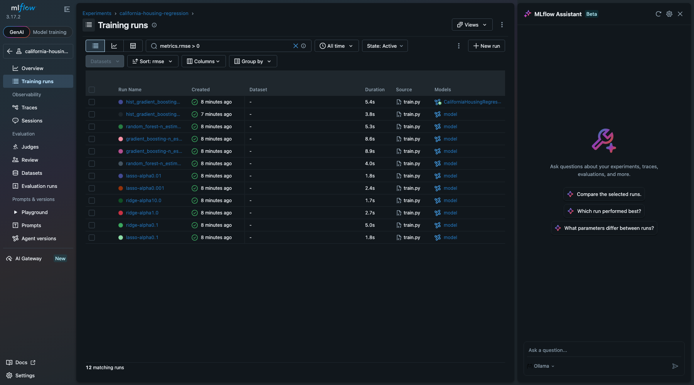
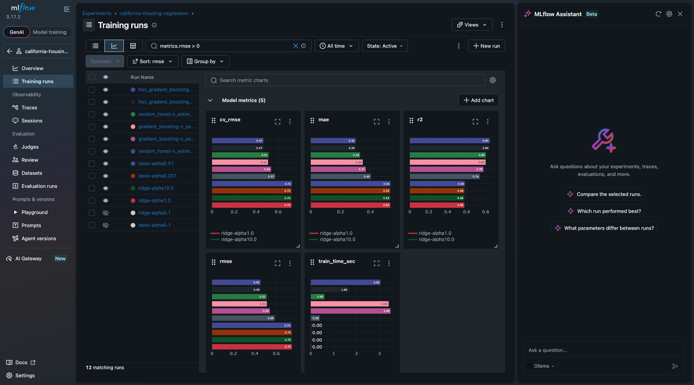
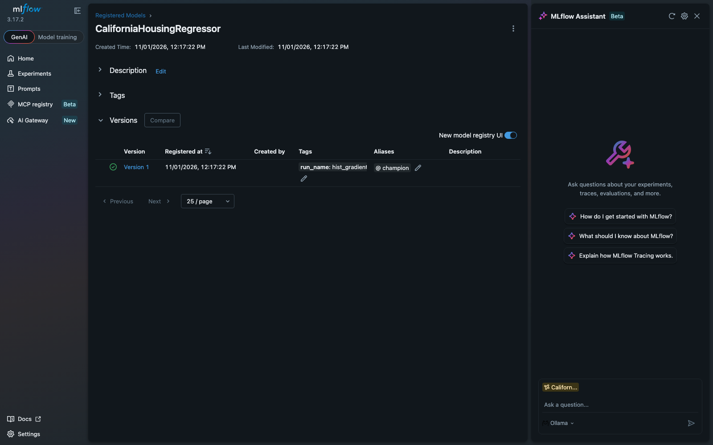

# MLflow Experiment Tracking Lab: California Housing

My version of [Experiment_Tracking_Labs / Mlflow_Labs / Lab1](https://github.com/raminmohammadi/MLOps/tree/main/Labs/Experiment_Tracking_Labs/Mlflow_Labs/Lab1) from the MLOps course repo.

The original lab trains a single ElasticNet model on the Wine Quality dataset and logs one run to MLflow. This version compares several model families on a different dataset, organizes the runs as a parent run with nested child runs, logs richer metrics and artifacts, and uses the MLflow Model Registry to promote and serve the best model.

## What I changed

| | Original Lab1 | This lab |
|---|---|---|
| Dataset | Wine Quality (red), 1,599 rows | California Housing, 20,640 rows, 8 features |
| Models | ElasticNet only | Ridge, Lasso, RandomForest, GradientBoosting, HistGradientBoosting |
| Hyperparameters | One run per CLI call | Built-in sweep, 12 configurations |
| Run structure | Flat single run | `model-comparison` parent run with 12 nested child runs |
| Metrics | RMSE, MAE, R² | RMSE, MAE, R², 5-fold CV RMSE, training time |
| Artifacts | Model only | Model + predicted-vs-actual and residual plots + feature-importance chart + leaderboard table |
| Tracking backend | Local file store (no registry) | SQLite (`mlflow.db`), so the Model Registry works locally |
| Registry | Skipped on file store | Best run registered as `CaliforniaHousingRegressor`, tagged with the `champion` alias |
| Inference | `serving.py` (pip requirements demo) | `predict.py` loads `models:/CaliforniaHousingRegressor@champion` for batch inference |

## Project structure

```
train.py          # sweep, logging, registry promotion
predict.py        # load champion model from the registry and predict
requirements.txt
```

## How to run

```bash
python3 -m venv .venv
source .venv/bin/activate
pip install -r requirements.txt

python train.py                 # full run, about 2-3 minutes
python train.py --sample-frac 0.2   # quick run on 20% of the data

python predict.py               # batch inference with the champion model

mlflow ui --backend-store-uri sqlite:///mlflow.db   # open http://127.0.0.1:5000
```

> **macOS note:** if the dataset download fails with `CERTIFICATE_VERIFY_FAILED`, your python.org Python has no CA certificates installed. Either run `/Applications/Python 3.x/Install Certificates.command`, or run `export SSL_CERT_FILE=$(python -c "import certifi; print(certifi.where())")` before `train.py`.

## Results

Test-set results (80/20 split, `random_state=42`), sorted by RMSE. The target is median house value in units of $100k.

| Run | RMSE | MAE | R² | CV RMSE |
|---|---|---|---|---|
| **hist_gradient_boosting (lr=0.05)** | **0.4531** | **0.3010** | **0.8433** | 0.4657 |
| hist_gradient_boosting (lr=0.1) | 0.4541 | 0.3015 | 0.8427 | 0.4658 |
| random_forest (max_depth=16) | 0.5092 | 0.3307 | 0.8021 | 0.5128 |
| gradient_boosting (lr=0.1) | 0.5114 | 0.3484 | 0.8004 | 0.5073 |
| gradient_boosting (lr=0.05) | 0.5397 | 0.3691 | 0.7777 | 0.5356 |
| random_forest (max_depth=8) | 0.5855 | 0.4026 | 0.7384 | 0.5729 |
| lasso (alpha=0.01) | 0.7404 | 0.5353 | 0.5816 | 0.7240 |
| ridge (alpha=0.1–10) | ~0.7455 | ~0.5332 | ~0.576 | ~0.7205 |
| lasso (alpha=0.1) | 0.8244 | 0.6222 | 0.4814 | 0.8198 |

**Takeaways**
- The tree ensembles beat the linear models by a wide margin (R² 0.84 vs 0.58), because house prices depend non-linearly on location (latitude/longitude) and income.
- Ridge barely changes across alpha values. With 8 features and 16k training rows, regularization has little to do.
- HistGradientBoosting had the lowest test RMSE, so it was registered and promoted to `champion`. Training times for every run are logged as `train_time_sec` and can be compared in the MLflow UI.
- Test RMSE and CV RMSE agree closely for every model, so the test split isn't giving a misleading result.

## Screenshots

**All 12 child runs, sorted by test RMSE.** The top run carries the registered `CaliforniaHousingRegressor` model.



**Run comparison charts:** cv_rmse, mae, r2, rmse and train_time_sec across all model configurations.



**Model Registry:** version 1 (HistGradientBoosting) with the `champion` alias.


